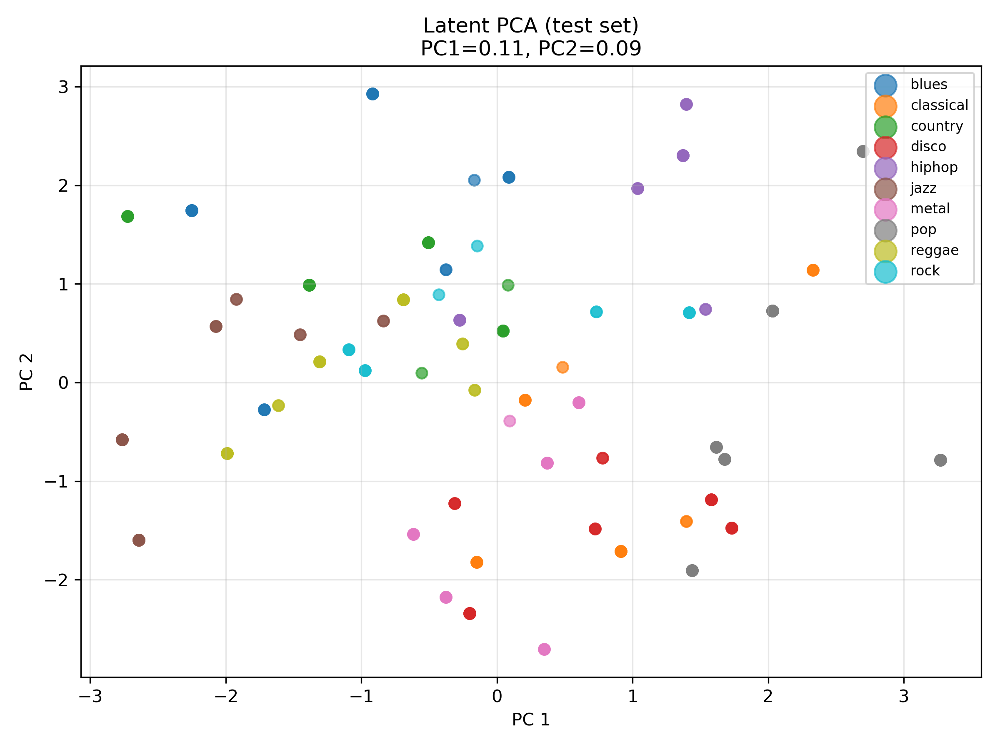
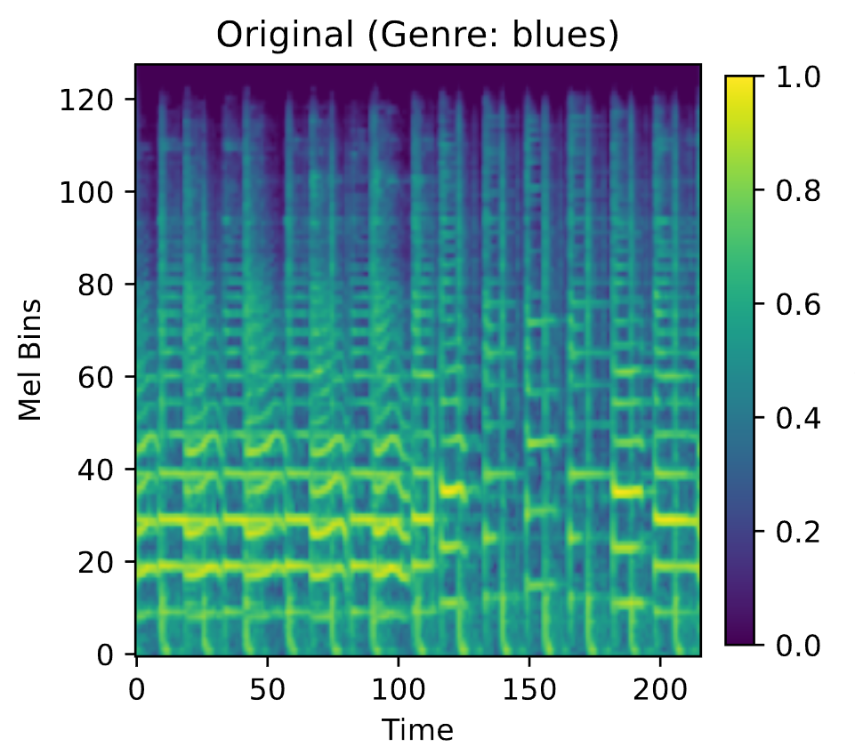
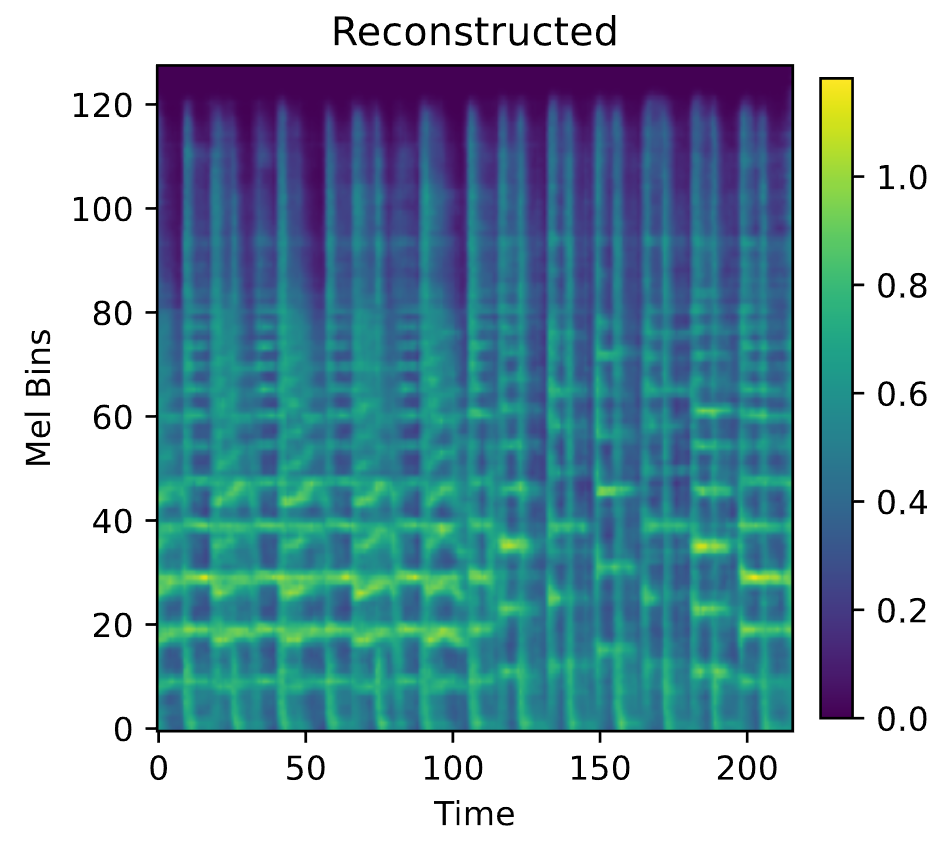
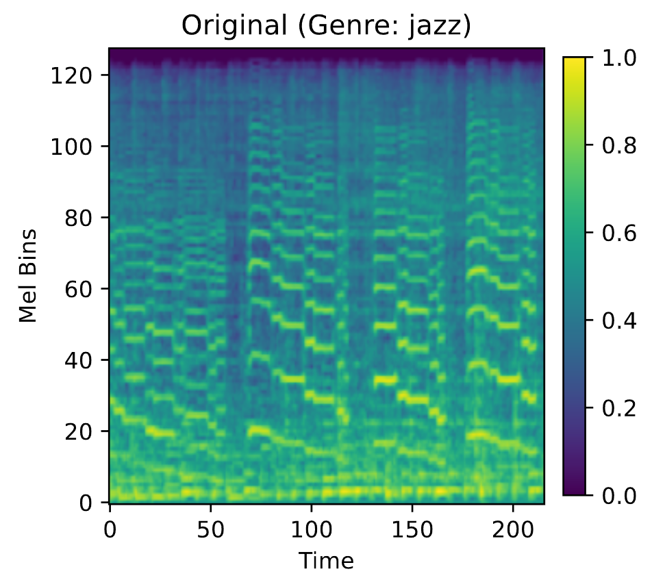
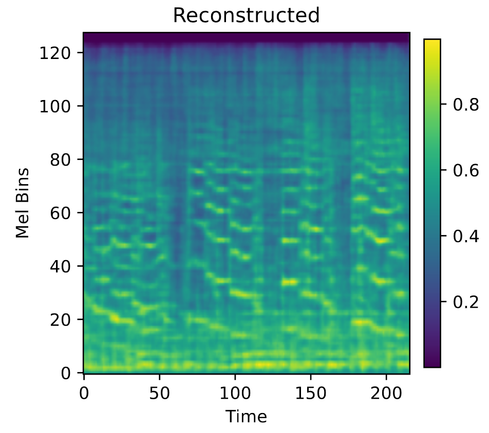

# MUSE-VAE

Convolutional variational autoencoder (VAE) for musical mel spectrograms, trained on the
[GTZAN](https://www.ee.columbia.edu/~dpwe/data/musicgenres/) dataset.
Course project for **STA 571: Advanced Probabilistic Machine Learning** (Duke University).
Full write-up (paper) available on request.

## Why a VAE, and why convolutional

- **VAE** — the goal is a *probabilistic* representation of music, not just compression.
  The encoder outputs (μ, log σ²) instead of a point, so the latent space is a continuous
  distribution we can sample from, interpolate over, and analyze — the paper focuses on
  what structure the encoder learns there.
- **Convolutional** — a mel spectrogram is a 2D image (frequency × time). A conv stack
  exploits that local structure (harmonic stacks, frequency bands) with weight sharing,
  then flattens into a 1024-dim latent.
- **β-VAE with annealing** — L1 reconstruction loss plus a KL term (β = 0.0005) linearly
  annealed over 30 epochs. Reconstruction is prioritized first, then the latent is pushed
  toward the Gaussian prior so it becomes *structured* rather than memorized. The resulting
  fidelity-vs-structure trade-off is what the analysis below measures.

## Why this analysis

- **PCA over the latent space** (encoder means, test split) — the claim to test is that the
  encoder learned genre structure. Projecting the 1024-dim latent to 2D makes that claim
  visually falsifiable: genres separate in latent space even at low β, consistent with known
  VAE behavior.
- **Spectrogram reconstructions** (original vs. reconstructed) — show what the model kept
  (harmonics, rhythm) versus what the regularization smoothed away.

## Results

**Latent space (PCA, test split):**



**Reconstructions (original → reconstructed):**

| Blues — original | Blues — reconstructed |
|---|---|
|  |  |

| Jazz — original | Jazz — reconstructed |
|---|---|
|  |  |

## Data

**GTZAN** (Tzanetakis & Cook, 2002): 1000 tracks, 10 genres × 100, 30-second clips. The
audio is not redistributed with this repo — download it and extract to
`./GTZAN_Dataset/genres_original/`. `model_src/GTZAN_DATA_MASTER.csv` (in this repo) is the
manifest this project generated from it: 5820 five-second mel segments (6 per clip) with
paths, shapes, and genre labels.

## Reproducibility

From the repo root (Python ≥ 3.9; GPU recommended):

```bash
pip install -e .
```

1. **Preprocess** — GTZAN → five-second mel spectrograms + the manifest CSV:

   ```bash
   python model_src/GTZAN_Processor.py
   ```

2. **Configure** — hyperparameters, splits, and experiment name live in
   [`model_frameworks/config.yaml`](model_frameworks/config.yaml).

3. **Train + evaluate** — per config, this driver runs training, spectrogram
   reconstruction, Griffin-Lim audio reconstruction, and latent-space PCA:

   ```bash
   bash train_and_predict.sh
   ```

   Or step by step (each takes `--config model_frameworks/config.yaml`):
   `model_src/Training-Pipeline.py` → `Predicting-Pipeline.py` →
   `Audio-Process-Pipeline.py` → `Latent-Space-Pipeline.py`.

4. **Vocoder smoke test** (no data needed):

   ```bash
   python model_src/Vocoder_Unit_Test.py
   ```

Notes:

- Training logs to **Weights & Biases** (`wandb login` first); checkpoints land in
  `TrainedModels/<experiment>/` and the best-checkpoint path is written back into
  `config.yaml`.
- The evaluation scripts read `checkpoint_path` from the config, so run training first
  (or set the path manually).

## Experimental: Griffin-Lim vocoder

[`model_src/Vocoder.py`](model_src/Vocoder.py) turns (reconstructed) mel spectrograms back
into waveforms via inverse-mel + Griffin-Lim phase estimation. It works but fidelity is
limited (phase estimation; the mel scale is power-based while Griffin-Lim expects
amplitude) — included as an exploration of mel → audio, with a self-contained test in
`model_src/Vocoder_Unit_Test.py`.

## Credits

- Dataset: G. Tzanetakis and P. Cook, *Musical Genre Classification of Audio Signals*,
  IEEE Transactions on Speech and Audio Processing 10(5), 2002.
- Built with [PyTorch](https://pytorch.org/), [PyTorch Lightning](https://www.pytorchlightning.ai/),
  [torchaudio](https://pytorch.org/audio/), [librosa](https://librosa.org/), and
  [Weights & Biases](https://wandb.ai/).
